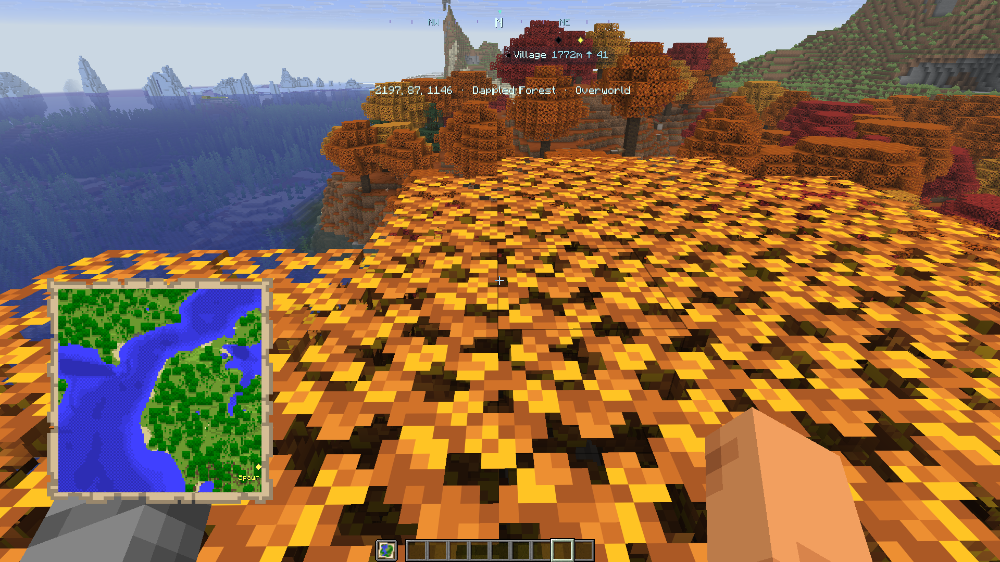
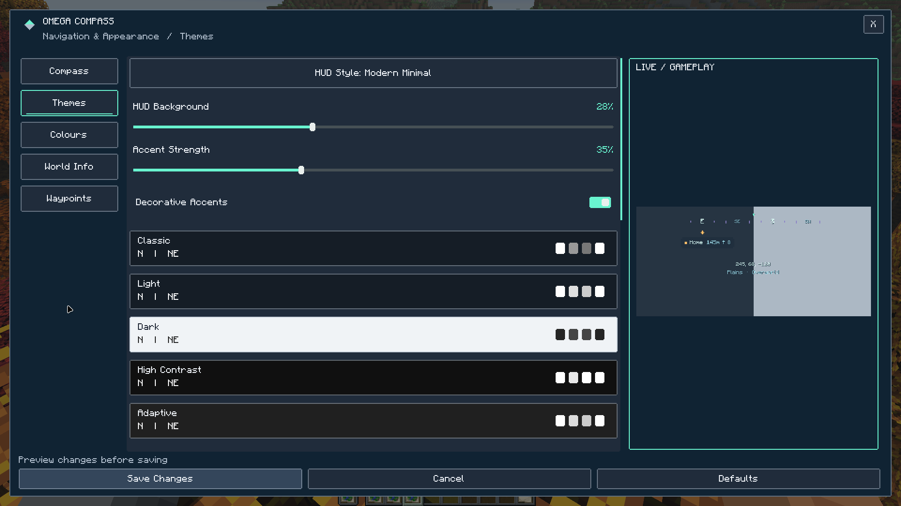
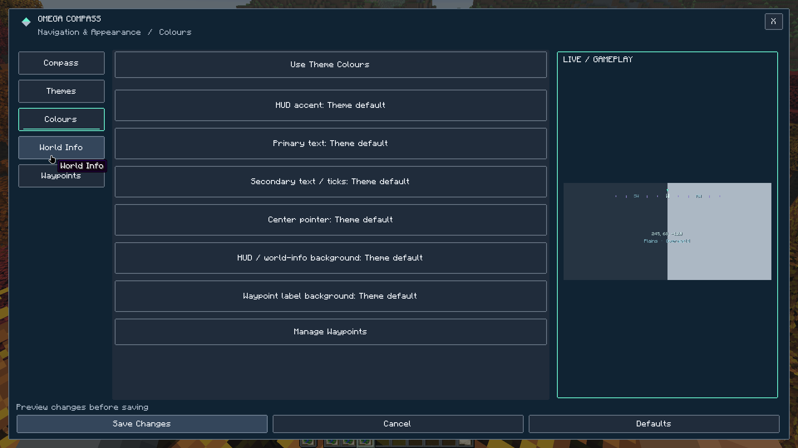
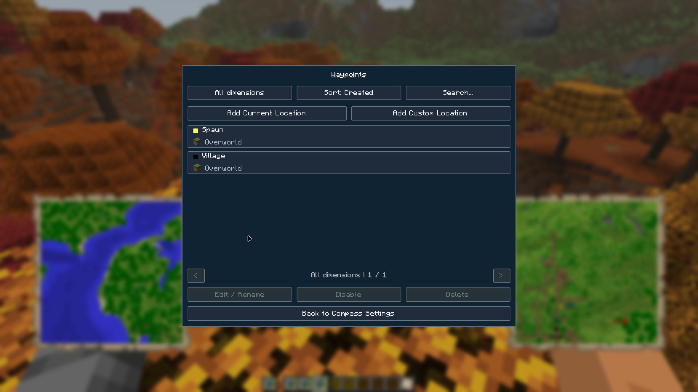
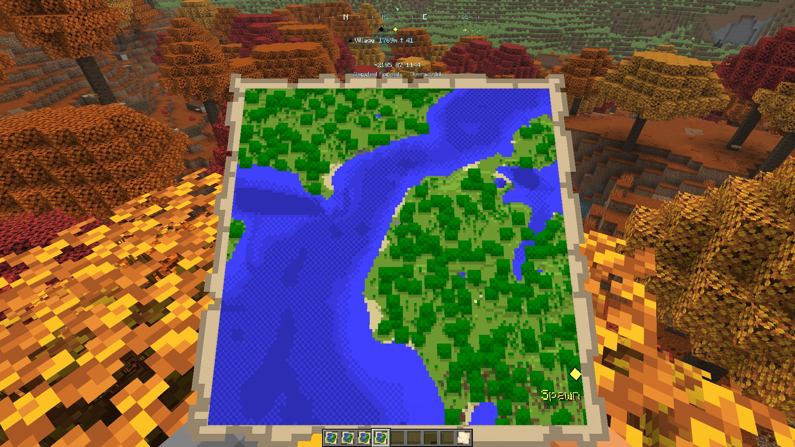

# 🧭 Omega Compass: Next Generation

**SINGLEPLAYER ONLY — EARLY ACCESS**

A modern Minecraft compass and waypoint navigation mod, designed to keep your
heading, destinations and world information clear without opening a full-screen map.

## Download

➡️ **[Get the latest Early Access build from Releases](https://github.com/hijackedmuffin/OmegaCompass-Releases/releases)**

Choose **OmegaCompass-26.3-1.1.0-rc.1.jar** under the release's **Assets**.
The automatically generated source ZIP/TAR files are not the mod.
A `SHA256SUMS.txt` file is included so you can verify your download.

| Requirement | Supported release environment |
| --- | --- |
| Minecraft | Java Edition **26.3** |
| Mod loader | **Minecraft Forge 66.1.8** |
| Java | **25** |
| Release | **v1.1.0-rc.1 — Pre-release** |

This build targets Forge, not Fabric or NeoForge. It is a client mod; do not install
it on a dedicated server.

## 📸 Screenshots

Explore the current **singleplayer Early Access** experience in Minecraft 26.3.

### In-game navigation

*Smooth compass navigation and world information while exploring Minecraft with a held map.*

### Customization and waypoints

| Themes & HUD styles | Custom colours |
| :---: | :---: |
|  |  |
| Choose themes, visual styles and appearance settings. | Fine-tune colours with live previews. |

| Waypoint manager | Waypoints on held maps |
| :---: | :---: |
|  |  |
| Create, organize and manage saved destinations. | View waypoint markers on vanilla Filled Maps in **singleplayer**. |

## Navigate your world

- Smooth rotating compass HUD with cardinal and diagonal directions.
- **17 themes**, four visual styles and custom colours.
- A modern settings dashboard with live previews and compass appearance controls.
- World coordinates, biome and dimension information.
- Create, edit and manage waypoints with custom colours.
- Coloured compass waypoint markers with distance and elevation indicators.
- Waypoint markers on vanilla held Filled Maps in singleplayer.
- Persistent settings and waypoint records across restarts.

Press **K while in a world** to open settings. Use **Manage Waypoints** to add your
current location or create a custom destination. Use **Save Changes** to keep HUD
settings, or Cancel/Escape to discard pending HUD edits.

## Install

1. Install Minecraft Java **26.3**, Minecraft Forge **66.1.8** and Java **25**.
2. Start that Forge installation once, then close Minecraft.
3. Download the release JAR from this repository's [Releases page](https://github.com/hijackedmuffin/OmegaCompass-Releases/releases).
4. Put the JAR in the **mods** folder inside your selected Minecraft game directory.
   Create `mods` if it is absent. Do not unzip the JAR; keep only one Omega Compass copy.
5. Start Forge, check that **Omega Compass** appears in Mods, and enter a singleplayer world.
6. Press **K** to customize the HUD and manage waypoints.

For this Early Access build, a separate game directory and a new test world are
recommended. Back up worlds and settings before changing your mod setup.
No additional mod dependencies are required beyond Forge.

## Singleplayer Early Access

**Omega Compass is currently intended for singleplayer. Multiplayer support is not officially available in this release.**

- Precise held-map waypoint metadata requires singleplayer's integrated server.
- Crowded waypoint labels may be hidden for readability; coincident markers can overlap.
- Some nonessential UI elements are simplified or hidden on very small screens.
  Lower GUI scale or enlarge the window if needed.
- Legacy style deliberately keeps its classic appearance; colour samples demonstrate
  RGB independently of gameplay opacity or hidden HUD elements.

## 🚀 MORE FEATURES COMING

**More features, improvements and compatibility updates are planned. This is an early release, and development is ongoing.**

No specific future feature, compatibility target or release date is promised.

## Feedback

Found a problem? Open an [issue](https://github.com/hijackedmuffin/OmegaCompass-Releases/issues)
with your Minecraft/Forge/Java versions, steps to reproduce, GUI scale and a screenshot
or relevant log excerpt. Remove account details, access tokens and other private data
before sharing logs.

This repository contains official release documentation and downloadable builds.
It does not contain the private development source or its history.
